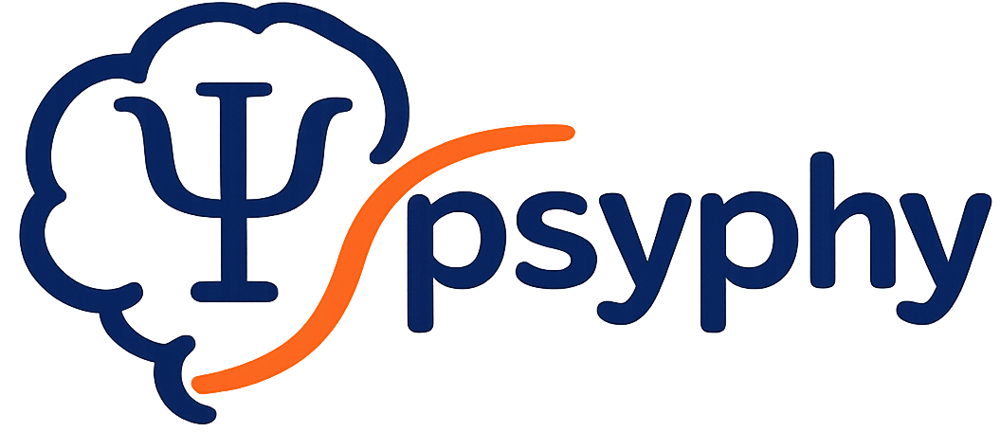

<div align="center">
    <picture>
      <source srcset="images/psyphy_logo.png" media="(prefers-color-scheme: light)"/>
      <source srcset="images/psyphy_logo.png"  media="(prefers-color-scheme: dark)"/>
      
    </picture>
    <h3>Active-learning-driven adaptive experimentation in psychophysics</h3>
</div>


<h4 align="center">
  <a href="https://flatironinstitute.github.io/psyphy/reference/">Documentation</a> |
  <a href="https://flatironinstitute.github.io/psyphy/examples/">Examples</a> |
  <a href="https://flatironinstitute.github.io/psyphy/CONTRIBUTING/">Contributing</a>
</h4>


## Install
`psyphy` supports Python 3.10 and later. We recommend installing `psyphy` under a virtual environment. Once you've created a virtual environment for `psyphy` and activated it, you can install `psyphy` using pip:

```bash
pip install psyphy
```

If you're a developer or want the latest features, install from GitHub:
```bash
git clone https://github.com/flatironinstitute/psyphy.git
cd psyphy
pip install -e .
```

## What is in psyphy?

`psyphy` is an open-source, JAX-based package for psychophysics research. It fits Bayesian
models of perceptual discrimination, currently the Wishart Process Psychophysical Model
(WPPM), on CPU or GPU. A fit gives either a single maximum a posteriori (MAP) estimate or
samples from the full posterior with the No-U-Turn Sampler (NUTS). The aim is to use that
posterior to choose the next trial in an adaptive experiment.

The examples so far are on human color perception, but the model applies to any stimulus
space where discrimination noise varies smoothly.
